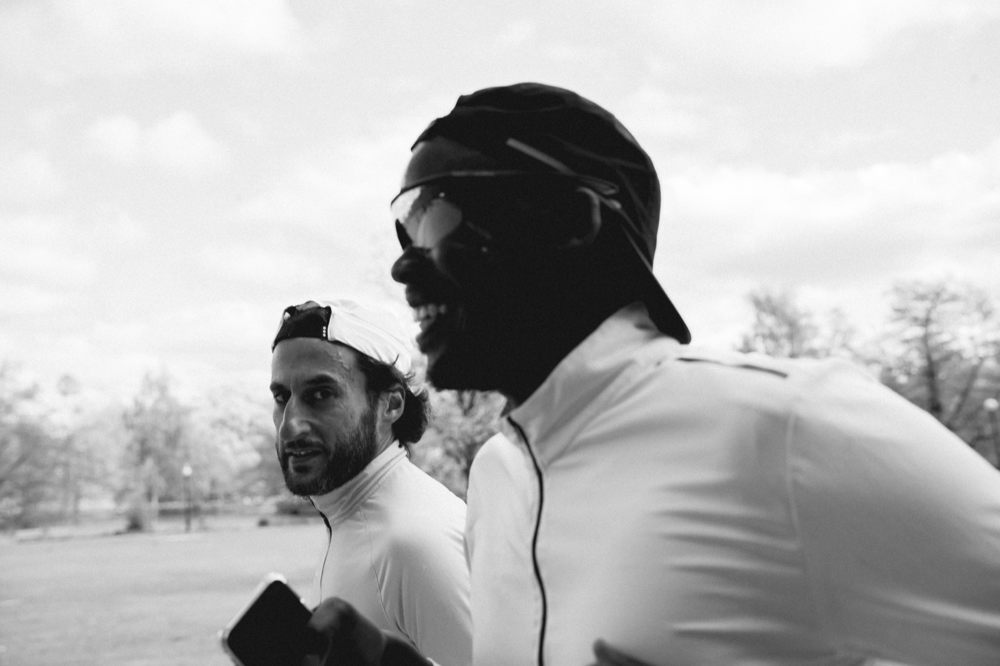
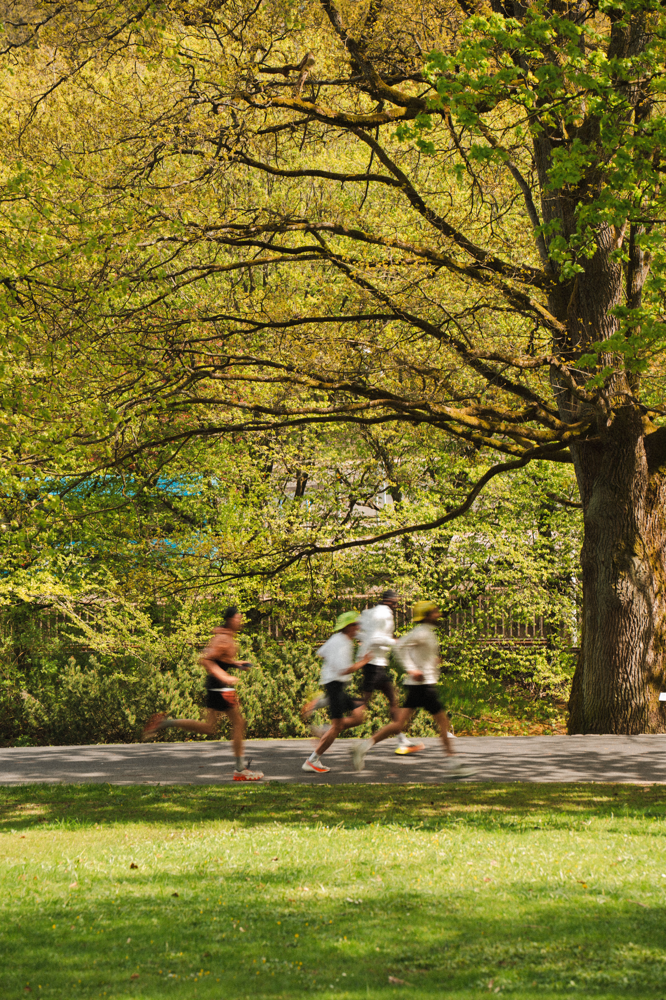
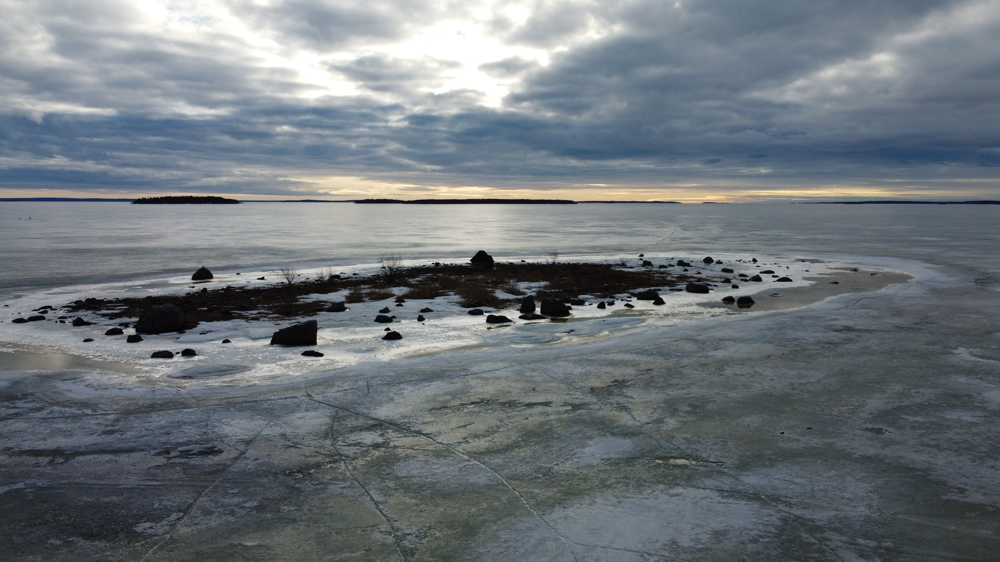
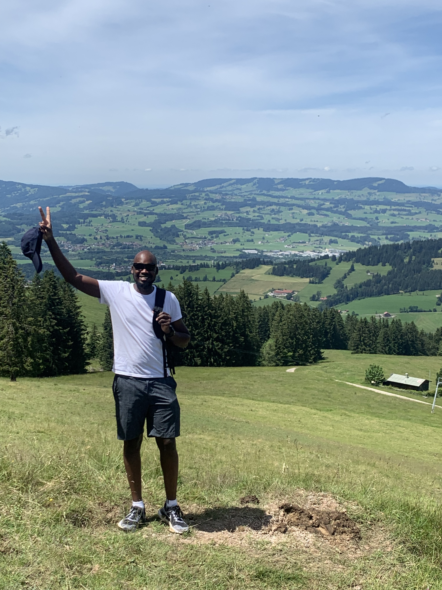
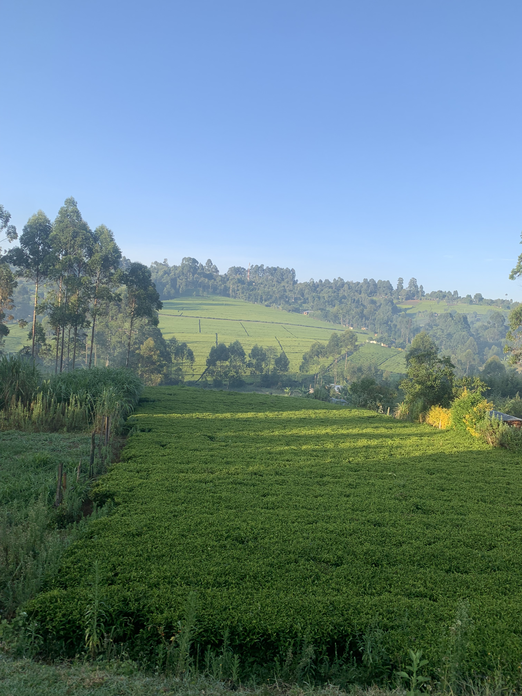

Outside research, I enjoy spending time outdoors, exploring new places, and capturing moments along the way. Photography, running, and hiking are among my favourite ways to unwind and experience the natural world.

### Photography

I enjoy capturing landscapes, nature, and moments from my travels and outdoor adventures.

  
  
  

### Running & Hiking

Running has long been a source of challenge, exploration, and perspective for me. I also enjoy hiking and discovering new landscapes, whether on familiar trails or in new places.

[Follow my running activities on Strava](https://www.strava.com/athletes/119102801).

### Runners United

Beyond my own running, I founded **[Runners United](https://www.strava.com/clubs/1179025)**, a Strava running club that combines a shared passion for running with giving back.

Through this initiative, we collect gently used running shoes that are still in good condition and pass them on to athletes in training camps in **Nandi Hills, Kenya**, providing additional pairs for training.

The idea is simple: **give running shoes a second life while supporting fellow runners.**

If you would like to contribute, collaborate, or partner with us, please [email me](mailto:kibiwottbrian@gmail.com) or connect with me on [Strava](https://www.strava.com/athletes/119102801).

