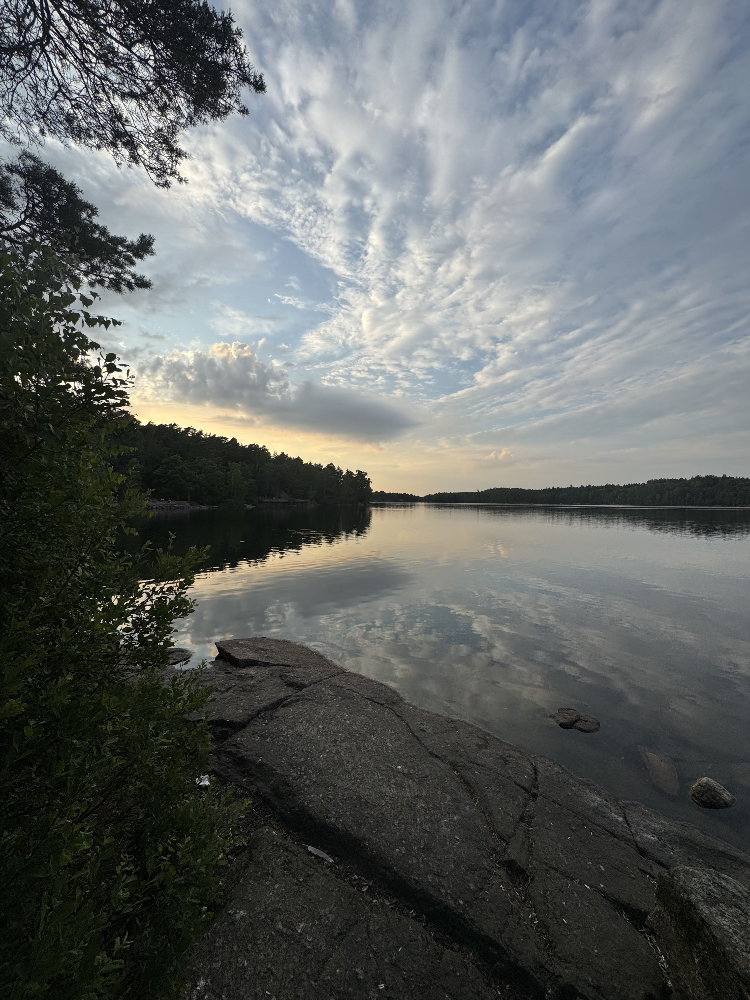
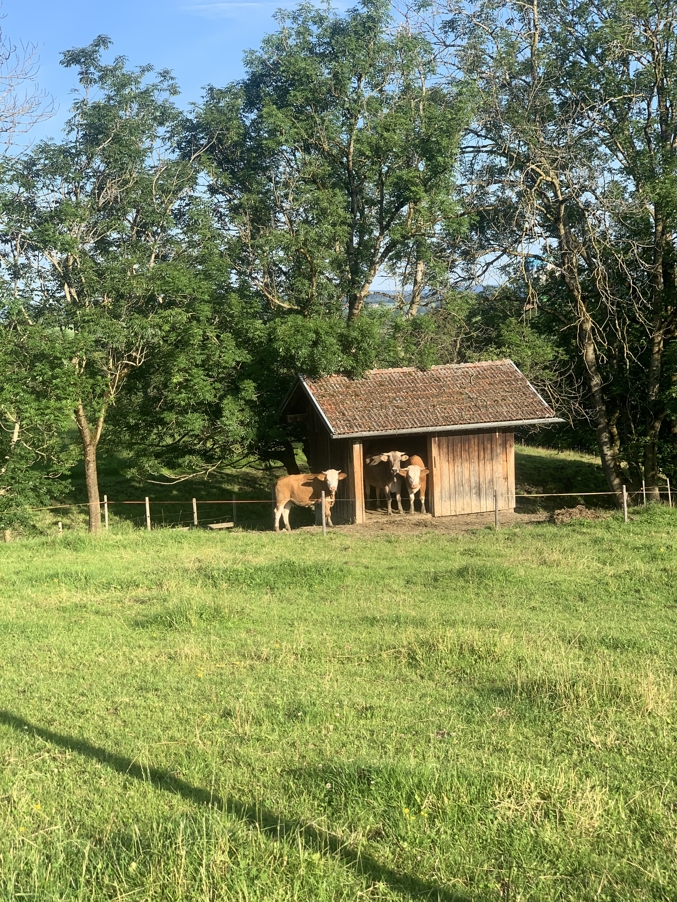

Outside research, I enjoy spending time outdoors, exploring new places, and capturing moments along the way. Photography, running, and hiking are among my favourite ways to unwind and experience the natural world.

## Photography

I enjoy capturing landscapes, nature, and moments from my travels and outdoor adventures.

  
  
  
  
  
  

<!-- Photo gallery will go here -->

## Running & Hiking

Running has long been a source of challenge, exploration, and perspective for me. I also enjoy hiking and discovering new landscapes, whether on familiar trails or in new places.

**Follow my running activities on [Strava](https://www.strava.com/athletes//119102801).**
